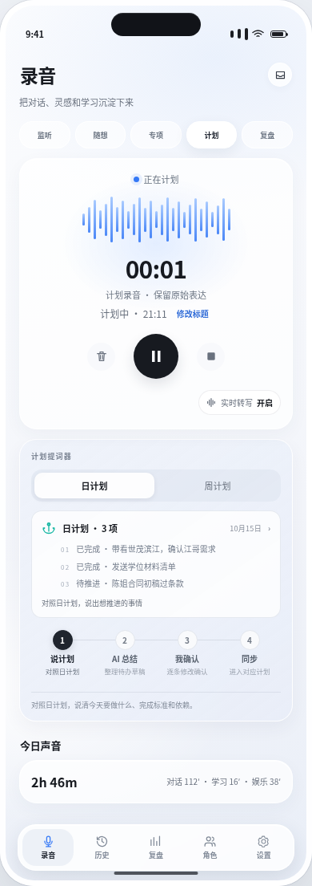
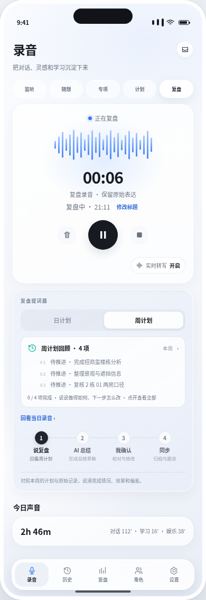
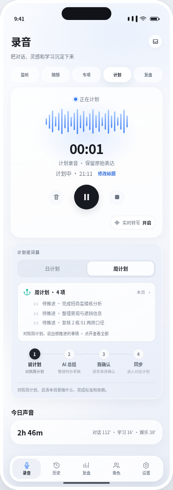
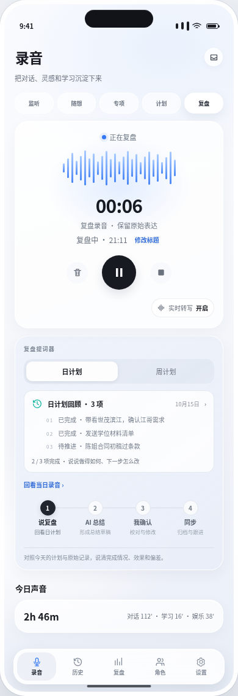

# 计划与复盘 · 录音卡和日／周提词器（HTML v1.4.2）

[在线打开原型](https://perfectyxs.github.io/tingdaohtml/?v=1.4.2) → 录音 → 计划／复盘。审核以本页直接展开的长图和实际 HTML 交互为准。

本次按用户截图调整：录音卡紧接模式栏，与监听保持同一顶部位置；计划和复盘的提词器均移到录音卡下方。两种模式各有“日计划／周计划”切换，分别记住当前选择。计划用来提示要推进的事项，复盘显示对应计划的完成情况，保留回看当日录音入口。

主责：HTML/交互/QA；执行：Codex；审核/批准：用户。范围仅为独立 HTML 原型；APK、正式 Releases 与架构审核状态未改变。计划/录音/完成情况是已有演示数据，未运行真实录音、ASR 或 AI。

## 录音卡位置直接对照

<table><tr><th>监听</th><th>计划 · 日计划</th><th>复盘 · 周计划</th></tr><tr><td valign="top"></td><td valign="top"></td><td valign="top"></td></tr></table>

普通画布中，三种模式的录音卡顶部距内容区起点均为 **136.05px**；提词器距录音卡底部 **12px**。320px 与 390px 窄屏分别核对同一相对位置，提词器无横向溢出。下面长图扩展 HTML 内容滚动区展示完整内容，底部导航只出现一次，不代表实际手机变成该截图高度。

## 计划模式 · 日计划

打开顺序：录音 → 计划 → 提词器“日计划”。

完整长图：390×1104。

- [ ] **监听／随想／专项／计划／复盘**：模式切换后，录音卡仍直接位于模式栏下方。 [录音架构](https://github.com/Perfectyxs/Earthonline/blob/feature/alpha11-html-audit/docs/ARCHITECTURE.md#s1-capture-transcription)
- [ ] **修改标题、丢弃、开始／暂停、结束保存、实时转写**：保留既有录音卡控件；本轮未重新验证全部旧录音模拟流程。 [录音架构](https://github.com/Perfectyxs/Earthonline/blob/feature/alpha11-html-audit/docs/ARCHITECTURE.md#s1-capture-transcription)
- [ ] **日计划／周计划**：切换计划范围；不改变当前录音模式、录音状态或计时；计划和复盘各自记住选择。 [计划架构](https://github.com/Perfectyxs/Earthonline/blob/feature/alpha11-html-audit/docs/ARCHITECTURE.md#s5-plan-execution)
- [ ] **日计划内容卡**：显示对应范围事项；点击直接打开所选日期的日计划列表。 [计划架构](https://github.com/Perfectyxs/Earthonline/blob/feature/alpha11-html-audit/docs/ARCHITECTURE.md#s5-plan-execution)
- [ ] **说计划／AI 总结／我确认／同步**：四步能切换说明；切换日周保持当前步骤，AI 步骤明确尚需接入服务。 [流程架构](https://github.com/Perfectyxs/Earthonline/blob/feature/alpha11-html-audit/docs/ARCHITECTURE.md#feature-data-flow)

| 建议修正位置 | 你的意见 |
| --- | --- |
| 审核结论（通过／需改／待确认） | |
| 画面或按钮 | |
| 建议修改（1、2、3） | |
| 期望点击结果 | |

## 计划模式 · 周计划

打开顺序：录音 → 计划 → 提词器“周计划”。

完整长图：390×1104。

- [ ] **监听／随想／专项／计划／复盘**：模式切换后，录音卡仍直接位于模式栏下方。 [录音架构](https://github.com/Perfectyxs/Earthonline/blob/feature/alpha11-html-audit/docs/ARCHITECTURE.md#s1-capture-transcription)
- [ ] **修改标题、丢弃、开始／暂停、结束保存、实时转写**：保留既有录音卡控件；本轮未重新验证全部旧录音模拟流程。 [录音架构](https://github.com/Perfectyxs/Earthonline/blob/feature/alpha11-html-audit/docs/ARCHITECTURE.md#s1-capture-transcription)
- [ ] **日计划／周计划**：切换计划范围；不改变当前录音模式、录音状态或计时；计划和复盘各自记住选择。 [计划架构](https://github.com/Perfectyxs/Earthonline/blob/feature/alpha11-html-audit/docs/ARCHITECTURE.md#s5-plan-execution)
- [ ] **周计划内容卡**：显示对应范围事项；点击直接打开已有周计划锚和执行树。 [计划架构](https://github.com/Perfectyxs/Earthonline/blob/feature/alpha11-html-audit/docs/ARCHITECTURE.md#s5-plan-execution)
- [ ] **说计划／AI 总结／我确认／同步**：四步能切换说明；切换日周保持当前步骤，AI 步骤明确尚需接入服务。 [流程架构](https://github.com/Perfectyxs/Earthonline/blob/feature/alpha11-html-audit/docs/ARCHITECTURE.md#feature-data-flow)

| 建议修正位置 | 你的意见 |
| --- | --- |
| 审核结论（通过／需改／待确认） | |
| 画面或按钮 | |
| 建议修改（1、2、3） | |
| 期望点击结果 | |

## 复盘模式 · 日计划

打开顺序：录音 → 复盘 → 提词器“日计划”。

完整长图：390×1134。

- [ ] **监听／随想／专项／计划／复盘**：模式切换后，录音卡仍直接位于模式栏下方。 [录音架构](https://github.com/Perfectyxs/Earthonline/blob/feature/alpha11-html-audit/docs/ARCHITECTURE.md#s1-capture-transcription)
- [ ] **修改标题、丢弃、开始／暂停、结束保存、实时转写**：保留既有录音卡控件；本轮未重新验证全部旧录音模拟流程。 [录音架构](https://github.com/Perfectyxs/Earthonline/blob/feature/alpha11-html-audit/docs/ARCHITECTURE.md#s1-capture-transcription)
- [ ] **日计划／周计划**：切换计划范围；不改变当前录音模式、录音状态或计时；计划和复盘各自记住选择。 [计划架构](https://github.com/Perfectyxs/Earthonline/blob/feature/alpha11-html-audit/docs/ARCHITECTURE.md#s5-plan-execution)
- [ ] **日计划内容卡**：显示对应范围事项；点击直接打开所选日期的日计划列表。 [计划架构](https://github.com/Perfectyxs/Earthonline/blob/feature/alpha11-html-audit/docs/ARCHITECTURE.md#s5-plan-execution)
- [ ] **说复盘／AI 总结／我确认／同步**：四步能切换说明；切换日周保持当前步骤，AI 步骤明确尚需接入服务。 [流程架构](https://github.com/Perfectyxs/Earthonline/blob/feature/alpha11-html-audit/docs/ARCHITECTURE.md#feature-data-flow)
- [ ] **回看当日录音**：打开当前选定日期的既有录音列表；计划回顾不冒充自动生成的复盘报告。 [复盘架构](https://github.com/Perfectyxs/Earthonline/blob/feature/alpha11-html-audit/docs/ARCHITECTURE.md#s6-review)

| 建议修正位置 | 你的意见 |
| --- | --- |
| 审核结论（通过／需改／待确认） | |
| 画面或按钮 | |
| 建议修改（1、2、3） | |
| 期望点击结果 | |

## 复盘模式 · 周计划

打开顺序：录音 → 复盘 → 提词器“周计划”。

完整长图：390×1134。

- [ ] **监听／随想／专项／计划／复盘**：模式切换后，录音卡仍直接位于模式栏下方。 [录音架构](https://github.com/Perfectyxs/Earthonline/blob/feature/alpha11-html-audit/docs/ARCHITECTURE.md#s1-capture-transcription)
- [ ] **修改标题、丢弃、开始／暂停、结束保存、实时转写**：保留既有录音卡控件；本轮未重新验证全部旧录音模拟流程。 [录音架构](https://github.com/Perfectyxs/Earthonline/blob/feature/alpha11-html-audit/docs/ARCHITECTURE.md#s1-capture-transcription)
- [ ] **日计划／周计划**：切换计划范围；不改变当前录音模式、录音状态或计时；计划和复盘各自记住选择。 [计划架构](https://github.com/Perfectyxs/Earthonline/blob/feature/alpha11-html-audit/docs/ARCHITECTURE.md#s5-plan-execution)
- [ ] **周计划内容卡**：显示对应范围事项；点击直接打开已有周计划锚和执行树。 [计划架构](https://github.com/Perfectyxs/Earthonline/blob/feature/alpha11-html-audit/docs/ARCHITECTURE.md#s5-plan-execution)
- [ ] **说复盘／AI 总结／我确认／同步**：四步能切换说明；切换日周保持当前步骤，AI 步骤明确尚需接入服务。 [流程架构](https://github.com/Perfectyxs/Earthonline/blob/feature/alpha11-html-audit/docs/ARCHITECTURE.md#feature-data-flow)
- [ ] **回看当日录音**：打开当前选定日期的既有录音列表；计划回顾不冒充自动生成的复盘报告。 [复盘架构](https://github.com/Perfectyxs/Earthonline/blob/feature/alpha11-html-audit/docs/ARCHITECTURE.md#s6-review)

| 建议修正位置 | 你的意见 |
| --- | --- |
| 审核结论（通过／需改／待确认） | |
| 画面或按钮 | |
| 建议修改（1、2、3） | |
| 期望点击结果 | |

## 点开日计划后的页面

- [ ] **完成状态／详情／关闭／返回**：沿用已有日计划流程，列表按提词日期读取；本轮验证入口和日期范围，未重新验证所有任务编辑操作。 [计划架构](https://github.com/Perfectyxs/Earthonline/blob/feature/alpha11-html-audit/docs/ARCHITECTURE.md#s5-plan-execution)

| 建议修正位置 | 你的意见 |
| --- | --- |
| 日计划打开结果与按钮 | |

## 点开周计划后的页面

- [ ] **一级计划／子计划／编辑／完成状态／关闭／返回**：复用已有周计划执行树；本轮未改任务编辑层级。 [计划架构](https://github.com/Perfectyxs/Earthonline/blob/feature/alpha11-html-audit/docs/ARCHITECTURE.md#s5-plan-execution)

| 建议修正位置 | 你的意见 |
| --- | --- |
| 周计划打开结果与按钮 | |

## 浏览器检查范围

[14 项实际检查与尺寸记录](checks.json) · [复现脚本](../../tests/preview_recording_cues.py)。核对卡片位置、日周数据范围、实际入口、步骤切换、录音状态保留、日计划空态与两档窄屏；浏览器未出现 JavaScript 运行错误。人工验收框保持未勾选。

架构链接仅定位已有图，图仍待用户审核。本轮先给 HTML 视觉与交互预览，用户确认后再落实 APK。
