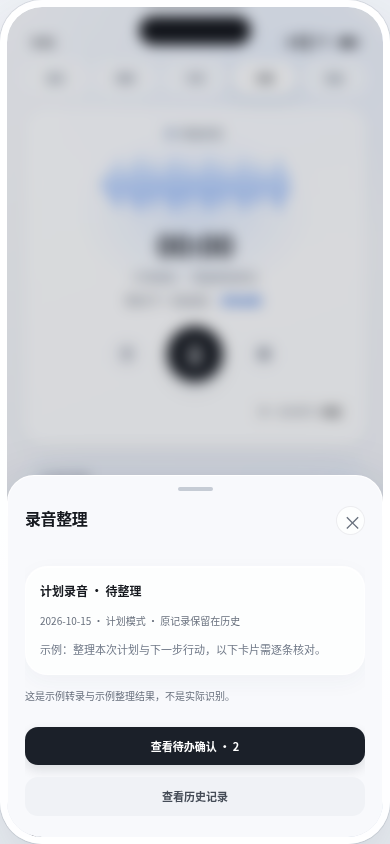
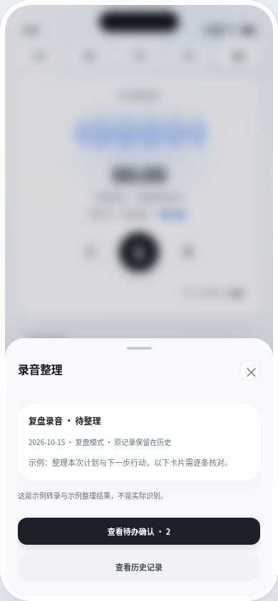

# 计划与复盘录音：整理、确认、同步

先在录音页选择计划或复盘，结束录音后打开整理页；“载入示例”展示示例转录、摘要和待确认卡。候选可修改标题、选择周期、忽略或确认；确认后进入本地计划。流程的“同步”展示本条录音的已确认及待确认数量。“同步”表示写入本地，不代表上传。

**当前为交互示例：没有执行真实录音、转录或 AI 推理。**真实稳定转录、本地 AI 模型、结果校验、失败重试和 APK 接入仍待开发。

## 计划：整理

- [ ] 来源、摘要和示例状态清晰；待办确认可打开。 [架构](https://github.com/Perfectyxs/Earthonline/blob/feature/alpha11-html-audit/docs/ARCHITECTURE.md#s2-summary-extraction)

建议修正：________

## 计划：待办确认

- [ ] 可编辑标题、选择周期、忽略、确认，确认后保留来源。 [架构](https://github.com/Perfectyxs/Earthonline/blob/feature/alpha11-html-audit/docs/ARCHITECTURE.md#todo-confirmation-flow)

建议修正：________

## 复盘：整理

- [ ] 复盘来源与示例状态清晰，可打开待办。 [架构](https://github.com/Perfectyxs/Earthonline/blob/feature/alpha11-html-audit/docs/ARCHITECTURE.md#s2-summary-extraction)

建议修正：________

## 复盘：待办确认

- [ ] 内容少时自然高度，增加内容时上扩至顶部导航栏下方并内部滚动。 [架构](https://github.com/Perfectyxs/Earthonline/blob/feature/alpha11-html-audit/docs/ARCHITECTURE.md#modal-presentation)

建议修正：________

截图为浏览器实际视口；流程说明和架构黄色增补待用户审核。两种模式的示例待办确认及来源写入已做浏览器检查，未做模型或 APK 验收。
