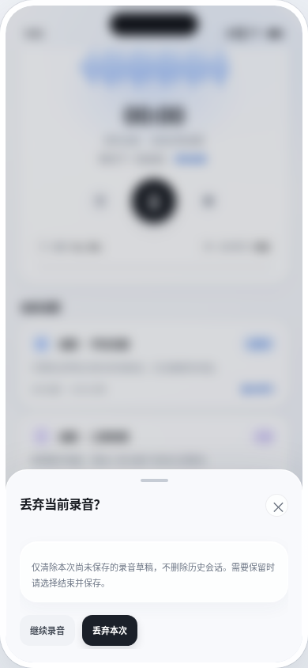

# 丢弃录音确认弹层

内容少时弹层随内容收缩，保留关闭、继续录音、丢弃本次。其余弹层沿用原有动态高度和顶部安全边界。

- [ ] **关闭／继续录音**：不清除当前录音草稿。
- [ ] **丢弃本次**：仅在明确确认后清除本次草稿。
- [ ] **高度**：内容少时下方不留大块空白；待办确认仍可随条目增加向上扩展、内部滚动。

截图为 HTML 浏览器实际视口；Android 功能与数据安全另行设备验证。
